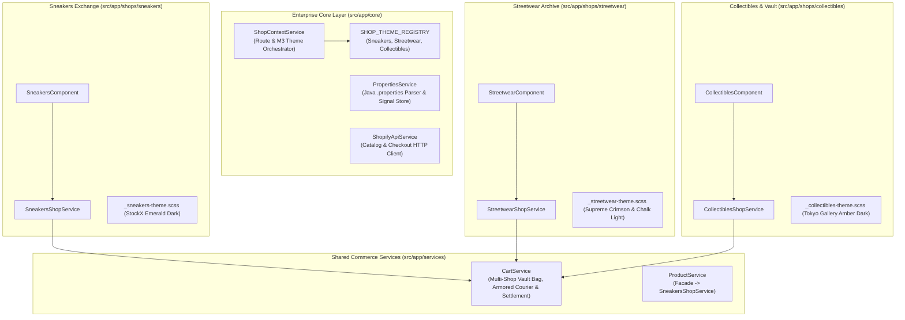

# KULTUREVAULT Exchange Holdings — Multi-Shop Systems Architecture Specification

## 1. Architectural Overview (Red Hat Java-Style Domain-Driven Design)

The KULTUREVAULT Exchange frontend application is architected into three isolated **Bounded Shop Contexts** under `src/app/shops/{sneakers,streetwear,collectibles}` supported by a shared enterprise core (`src/app/core/`) and a **Material Design 3 (Material You) HCT SCSS Token & Mixin Architecture** (`src/styles/`).

