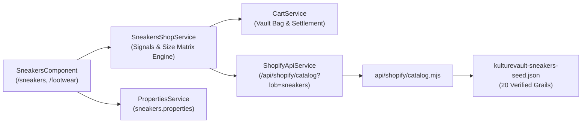

# KULTUREVAULT // Sneakers Exchange — Systems Architecture Specification

## 1. Domain-Driven Design (DDD) Bounded Context

The `sneakers` vertical (`src/app/shops/sneakers/`) is isolated as an autonomous bounded context extending `BaseCatalogProduct` via `SneakerProduct` (`src/app/shops/sneakers/models/sneakers.model.ts`).

### Domain Purity Invariants
- **Owned Attributes**: `style_code`, `colorway`, `release_year`, `authentication_badge`, `box_condition`, `size_matrix` (`US 8 / UK 7` through `US 12 / UK 11` with size-level `lowestAskZar`, `highestBidZar`, `lastSaleZar`, `stockQty`).
- **Zero Cross-Contamination**: Zero food (`halal_status`, `cold_chain_packaging`) or industrial (`standards_compliance`) fields.

## 2. Size-Matrix Bid/Ask Pricing Engine

When a user selects a US/UK size pill (`US 8`..`US 12`) on a sneaker card:
1. `SneakersShopService.setSelectedSize(productId, sizeUs)` updates the reactive `selectedSizes` signal dictionary.
2. `getSizeQuote(product)` resolves the exact `SneakerSizeQuote` entry for that size.
3. `getDisplayPrice(product)` returns `lowestAskZar` in `BUY_NOW` mode or `highestBidZar` (-8% maker quote) in `PLACE_BID` mode.
